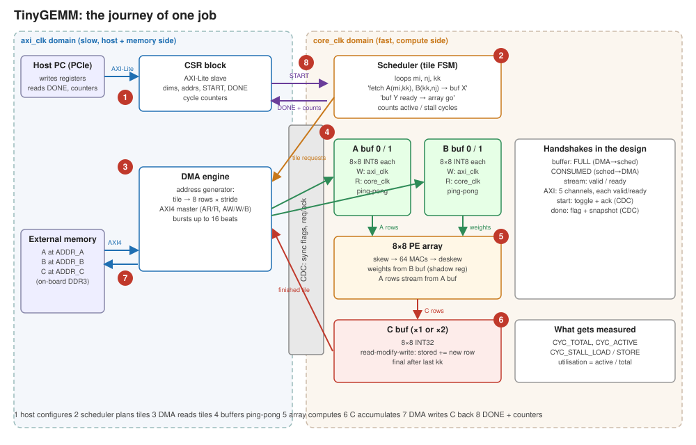
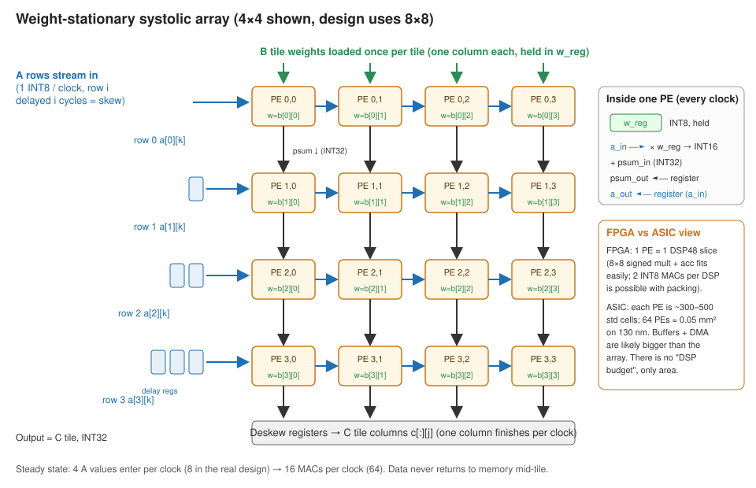

# GPT-2 FPGA Accelerator

An INT8 systolic-array accelerator for GPT-2 inference on a Kintex-7 FPGA. A custom AXI4 DMA streams matrices from on-board DDR3, a host PC controls the accelerator over PCIe, and hardware counters measure how busy the array actually is.

The compute engine is **TinyGEMM**, a weight-stationary systolic array that computes `C = A × B` (INT8 inputs, INT32 accumulation). Nearly all of the arithmetic in a transformer is matrix multiplication, so a fast, well-fed GEMM engine is the core of running GPT-2 in hardware.

> **Status: personal project, in progress.** The micro-architecture and performance model are complete; RTL and verification are the next stage. All performance figures below are pre-hardware projections from the [performance model](docs/performance_model.md) and will be replaced by measured numbers as bring-up progresses.

---

## Why this project

Running a language model is a memory problem more than a compute problem. When GPT-2 generates a token, every weight in the model is read from memory once, but each weight is used for only one multiply-accumulate. On this board the DDR3 delivers about 5 GB/s, while even a small 8×8 array can consume weights faster than that. Doubling the number of multipliers does not make tokens come out faster; moving fewer bytes does.

The project is built around that constraint: an efficient DMA and buffering scheme that keeps the array fed, hardware counters that measure utilisation directly, and a performance model that predicts where the bottleneck sits before any hardware is built.

## Architecture



| Block | Function |
|---|---|
| **8×8 systolic array** | 64 processing elements, one DSP48E1 each. Weights stay in place; rows of A stream left to right and partial sums flow downward. A shadow weight register loads the next tile during compute, so tile changes cost no cycles. |
| **Ping-pong tile buffers** | Two A and two B buffers in block RAM. The DMA fills one while the array reads the other. |
| **C buffer** | Accumulates INT32 partial results across the K dimension with read-modify-write. |
| **Scheduler** | Tile FSM that walks the output matrix, overlaps loading with compute and counts active and stall cycles. |
| **AXI4 DMA** | Bursting master with a tile-walking address generator; handles strided and ragged (non-multiple-of-8) matrices. |
| **CSR block** | AXI4-Lite registers for job setup, start/done, and the utilisation counters. |
| **Board integration** | Xilinx MIG (DDR3) and XDMA (PCIe) IP in a separate board layer, so the core stays vendor-independent. |

The array has two clock domains: a 200 MHz target compute clock, and a bus clock for the DMA, CSRs and the PCIe/DDR interconnect. All clock-domain crossing is confined to one library file.

<p align="center"></p>

The full design is in the [micro-architecture specification](docs/tinygemm_uarch_spec_v0.1.md), and a cycle-by-cycle example on a 2×2 array is in [systolic_walkthrough_2x2.svg](docs/systolic_walkthrough_2x2.svg).

## Target hardware

| | |
|---|---|
| FPGA | AMD/Xilinx Kintex-7 **XC7K325T-2FFG676C** |
| DSP slices | 840 DSP48E1 (the 8×8 array uses 64; the design scales to ~28×28) |
| Block RAM | 445 × 36 Kb (~2 MB) |
| Memory | 1 GB DDR3 (2 × Micron MT41K256M16, 32-bit bus), 6.4 GB/s peak |
| Host link | PCIe Gen2 x4, ~2 GB/s per direction |

## Projected performance

GPT-2 small (124M parameters) with INT8 weights, generating one token at a time:

| | Value |
|---|---|
| Peak compute, 8×8 array at 200 MHz | 12.8 GMAC/s (25.6 GOPS) |
| Weights read per token | 124 MB |
| Memory-bandwidth ceiling (5 GB/s usable) | **~40 tokens/s** |
| Projected with the v1 weight-stationary dataflow | **~13 tokens/s** (limited by how fast the array can load weights) |
| With INT4 weights | ceiling doubles to ~80 tokens/s |

Two observations from the model shape the design:

- **Token generation is memory-bound at any array size.** A full-chip 28×28 array would still hit the same 40 tokens/s ceiling, just with lower utilisation. The levers are fewer bytes per weight (INT4) and batching several sequences so each weight fetch is reused.
- **Prompt processing is compute-bound.** A 100-token prompt becomes a single large matrix multiply, so the array runs at close to 100% utilisation. This is the same reason LLM serving reports time-to-first-token separately from tokens per second.

The derivation, with every equation and intermediate number, is in [docs/performance_model.md](docs/performance_model.md).

## Verification

- **UVM 1.2 testbench in the Vivado Simulator**, run as a Tcl-scripted regression: AXI4-Lite and AXI4 memory agents (with configurable latency and backpressure), a SystemVerilog reference GEMM, a scoreboard and functional coverage.
- Tests cover single tiles, ragged dimensions, K = 1 and K = 4096, strided matrices, back-to-back jobs, soft reset mid-job and memory backpressure sweeps.
- SystemVerilog assertions on the buffer handshakes, the clock-domain crossings and the AXI4-Lite protocol.
- Board-level simulation with the MIG and XDMA models before hardware, then ILA-based debug on the board.

## Roadmap

- [x] Micro-architecture specification and performance model
- [ ] Core RTL (array, buffers, scheduler, DMA, CSRs) with a passing UVM regression
- [ ] Array and DDR3 on the board: timing closure, first job from DDR, measured bandwidth and utilisation
- [ ] PCIe host path: a PC loads matrices, runs jobs and reads results
- [ ] Optimisation: two INT8 MACs per DSP slice, buffer sizing, utilisation vs tile size and memory latency
- [ ] GPT-2 small layers running on the accelerator
- [ ] Future: weight-streaming dataflow for faster token generation; open-source ASIC port (Yosys + OpenROAD)

## Repository layout

```
docs/         specification, performance model, diagrams
datasheets/   board schematic, FPGA and memory datasheets, reference constraints
rtl/          technology-independent SystemVerilog core            (planned)
fpga/         board top level, vendor IP, constraints, Vivado build (planned)
tb/uvm/       UVM verification environment                         (planned)
host/         PC-side software over PCIe                           (planned)
```

## Tools

Vivado (scripted Tcl build flow), Vivado Simulator with UVM 1.2, SystemVerilog.
